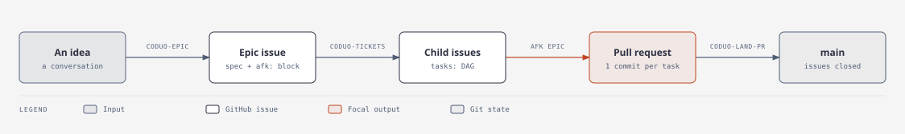
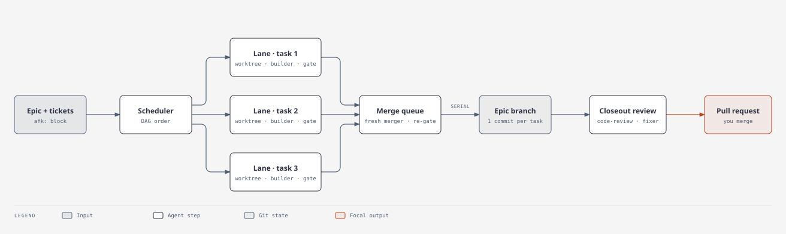

# coduo-afk

coduo-afk runs a GitHub epic while you are away from the keyboard. You write the epic and its child
issues; the runner builds each issue with a fresh coding agent in its own Git worktree, checks the
work with your project's own gates, merges the lanes one at a time, reviews the whole branch, and
leaves you one pull request to read and merge.

It is a package-free Node.js CLI (`afk`). Nothing is installed into your project.

## How it works



The work is planned by hand, with skills from [coduo-skills](https://github.com/sahildave/coduo-skills),
and built unattended by the runner:

1. **Write the epic.** `/coduo-epic` turns a conversation into one GitHub issue: the spec, plus a
   fenced `afk:` block that names the branch.
2. **Cut the tickets.** `/coduo-tickets` splits the epic into child issues, each one small enough for
   one agent, and writes their dependency graph back onto the epic as a `tasks:` block.
3. **Run it.** `afk epic <number>` builds every ticket and opens a pull request. This is the only
   unattended step.
4. **Land it.** You read the pull request and merge it. `/coduo-land-pr` closes the issues it shipped
   and removes the branches and worktrees.

Inside step 3:



- **Plan review.** Before any branch exists, a reviewer agent reads the epic and its tickets and
  refuses a graph that cannot be built as written.
- **Lanes.** The scheduler starts every ticket whose dependencies have passed, each in its own Git
  worktree with a fresh builder agent. A lane passes only when your configured checks pass in it.
- **Merge queue.** Finished lanes merge into the epic branch one at a time, each by a fresh merger
  agent, and the checks run again after every merge. The pull request opens at the first merge.
- **Closeout.** When the graph is done, a verifier reviews the whole branch against the epic with
  `code-review`, and a fixer resolves what it finds. The run stops at the pull request; merging it is yours.

Three files, three owners: the epic and its issues say **what** to build, `.afk-setup/config.yaml`
says **how** your stack is verified, and `.afk/state.json` says what is happening **now**.

## Requirements

- Node.js 20 or newer
- Git, with the work branching from `main` (or pass `--base=<branch>`)
- The `claude` CLI on `PATH` for `afk`, or the `codex` CLI for `afk-codex` (see
  [Two entry points](#two-entry-points))
- `gh`, signed in, when the project is on GitHub
- The [coduo-skills](https://github.com/sahildave/coduo-skills) plugins (next section)

## Install

1. Clone this repo and put the runner on your `PATH`:

   ```bash
   git clone https://github.com/sahildave/coduo-afk.git ~/code/coduo-afk
   ```
   ```bash
   ln -sf ~/code/coduo-afk/afk.mjs ~/.local/bin/afk
   ```

   `afk-codex.mjs` is the same runner on Codex; link it the same way if you want it.

2. Install the skills. The planning steps use them, and so do the agents inside a run: builders
   follow `coduo-implement` and `karpathy-guidelines`, and the closeout review runs `code-review`.

   ```bash
   claude plugin marketplace add sahildave/coduo-skills
   ```
   ```bash
   claude plugin install coduo@coduo-skills
   ```
   ```bash
   claude plugin install mattpocock-skills@coduo-skills
   ```

Every `afk` command runs **from the project you are working on**, not from this repo.

## Set up a project

Four things, once per repo. [docs/first-hour.md](docs/first-hour.md) is the long version.

1. **Propose the config.** From the project root:

   ```bash
   afk stack detect
   ```

   It is offline and free. It prints a `.afk-setup/config.yaml` block naming the skills each agent
   role gets for this stack, and lists any stack it has no skills for.

2. **Finish `.afk-setup/config.yaml` by hand.** `defaultChecks` is the field you cannot skip: a task
   with nothing to gate it stops the run. `worktreeSetup` is the one people forget: a lane worktree
   starts with no `node_modules` and no `.env.local`, so if your checks need them, `link` or `copy`
   them here. If a check is a native toolchain the Claude Code sandbox cannot hold (`xcodebuild`,
   `xcrun simctl`), also list it under `roles.verifier.gates`
   ([docs/permissions.md](docs/permissions.md), "What it can run").

3. **Add `.afk/` to `.gitignore`.** It is the runner's machine state. `.afk-setup/` is committed and
   yours; a run never writes to it.

4. **Write `AGENTS.md`.** What a new contributor would need and the code does not say. Each lane
   starts with no memory of the last one, so anything not written here does not exist.

Optional: `.afk-setup/prompts/<role>.md` replaces a role's shipped prompt for this project.

## Upgrading

This is the v2 runner (`afk --version`). [`CHANGELOG.md`](CHANGELOG.md) lists every breaking change
and takes precedence over any description of runner behaviour in your own project's docs. The epic
`afk:` block schema is still version 1, so existing epics keep validating.

## Run an epic

Three steps, three separate approvals. Write the epic from a conversation you have already had about
the feature:

> /coduo-epic

Then cut it into child issues and derive the dependency graph from their real issue numbers:

> /coduo-tickets

Then start the run:

> start an afk run on #123

`coduo-afk` validates the graph, creates the branch, launches the run, and reports what actually
happened — including the gated work waiting on a human. Add epic-wide context in the same sentence
and it reaches every lane and survives a restart:

> start an afk run on #123 — the design tokens moved to packages/ui last week, don't add new ones

Or drive it yourself, which is the same thing without the skill:

```bash
afk validate 123     # creates nothing: no branch, no worktree, no issue edit
afk epic 123         # the first command that spends tokens and writes history
```

Or, for one terminal per epic — the run detached so it survives the session, and a session to talk
to about it:

```bash
afk start 123
```

`start` launches `afk epic 123` in its own process group, waits until the run reports its branch and
its dashboard port, prints those with the checkout and the commands to check on it, and then opens
an interactive `claude` session in this checkout. **Closing that session does not stop the run.**
Every other argument is forwarded to `afk epic`. It refuses on STDOUT, naming the remedy, if
`claude` is not on `PATH`, if a runner already holds this checkout, or if the run dies before
it reports — a run that refused is never left looking like a hang.

Make the first epic on a new repo a throwaway. It tells you what your `defaultChecks` and `AGENTS.md`
got wrong, and you want to learn that on work you can delete.

## Usage

The two sections above are the path through. This one is the reference for every command and flag.

Start from a GitHub epic whose body carries an `afk:` block. `validate` reads the epic and its child
issues and prints the graph's depth and blast radius. It creates nothing — no branch, no worktree,
no `.afk/`, and it never edits the issue — so it is safe to run against anything:

```bash
afk validate 255
afk epic 255
```

`epic` runs the same validation and then creates the epic's branch and starts the run. Either
refuses rather than guessing: a task with no child issue, a `gate: after` (parsed, but with no
lifecycle yet), or a task nothing can gate — no `checks:` of its own and no `defaultChecks` in
`.afk-setup/config.yaml` to fall back on — stops the run and is named by id. A restart whose epic changed
shape (a task added, removed, re-pointed, or newly gated) is refused too; a retitled issue is not.

Use `--epic-body=<path>` to check a local block against the epic's real child issues before writing
it to the issue, and `--json` for the machine-readable report.

The `--dag=<path>` seam is still supported and takes the same JSON the bridge produces:

```bash
afk auto --dag=dag.json
afk status
afk dashboard
afk stats
afk stats --efficiency <id>   # where a lane's tokens went; --json for machines
```

`auto` starts the dashboard automatically and keeps it running for the runner's lifetime. Its
port is derived from this checkout's absolute path — so two checkouts of one project cannot collide —
and the URL is printed when the run starts. Set `PORT` to pin one. If a dashboard for the same
project is already running, the runner reuses it; a port serving another project is treated as
a preflight error.

Run a specific task, including a human-gated task:

```bash
afk run --task=211 --dag=dag.json
```

Work on a feature branch instead of `main` — tasks branch from it and integrate back into it. The
named branch must be the one currently checked out:

```bash
afk auto --dag=dag.json --base=my-feature
```

Reset a task's lifecycle back to pending:

```bash
afk reset 211
```

If you fixed a lane branch by hand after its builder finished, salvage it instead. `afk reset` would
start a new builder and drop the fix. `afk salvage` re-runs the lane's checks at the branch tip,
writes a fresh verification note there and marks the task ready to integrate; relaunch the run to
merge it. A red check changes nothing. If the tip already carries a verified note, salvage runs no
checks, keeps that note and only marks the task ready. Salvage refuses a task that already
succeeded, one whose dependencies have not, and a builder's note that does not parse. Commit any
uncommitted work in the lane worktree on the lane branch first; salvage refuses a dirty worktree. A hand-made commit meets only these checks and the
post-merge gate, not the builder's protected-path and lane-boundary checks. Salvage also requires a
lesson, in the shapes the closeout fixer uses: what the fix teaches becomes a lint rule with a red
fixture, a coding-standards line, or `none` with a reason. Without one it refuses. The lesson is
recorded in `.afk/state.json` (`midRunDefects`) and the closeout and PR body list it, as they list a
post-merge check that failed twice on the same tree with `Lesson: missing` until a salvage supplies it:

```bash
afk salvage 211 --lesson=rule:no-desktop-import:lint/rules/no-desktop-import.mjs:lint/fixtures/red/desktop-import.ts
afk salvage 211 --lesson=standard:"Never import a desktop-only module from shared code"
afk salvage 211 --lesson=none:"typo in a fixture; nothing to generalise"
```

If a closed epic's branch gets a later commit, `afk merge` refuses: its `review-at-head` and
`must-fix-cleared` guards read the closeout review, and a relaunch leaves a closed closeout alone.
Redo it at the current head. This re-runs the closeout verifier, the fix pass and its gate, and keeps
the earlier review, fix report and gate (`state.epicClose.redos`, `.afk/epic-close/<id>/redo/`). It
posts nothing to the issue, and it refuses while a run holds the lock, a lane is in flight, a gate
runs or waits, or the epic is not closed:

```bash
afk close --redo 203
```

When every lane has stopped, close the run out:

```bash
afk finish
```

It prints the closeout review already on disk (it never spawns one — that is `afk verify`, which
costs tokens), removes the lane worktrees and branches the run left behind, and prints the merge
command. It **merges nothing**: the PR is the last human checkpoint of a run nobody watched, the same
reason the closeout review is advisory and a `gate: after` needs an explicit `--accept`. It refuses
while `afk auto` holds the lock, while any lane is still moving, or while a gate is unaccepted, and
it deletes lane branches with `git branch -d` — an unmerged lane is named in the output, not
destroyed.

Run from an `afk epic --worktree` checkout with every task passed, it also removes that checkout
and the `~/code/worktrees/<clone>/epic/<id>/` folder around it (`~/.afk-claude/epics/<slug>-<id>/` for
a run started before #228) — including anything the project built
beside the checkout, such as a cargo `target-dir = "../target"` — after copying the run's `.afk/` to
the main checkout's `.afk/archive/epic-<id>/`. A failed task, uncommitted changes that are not the
runner's, a HEAD on no branch, a locked worktree, or anything in the folder besides the checkout and
build caches keeps the folder and says why. The epic's branch stays: it is the PR.

Tickets come from GitHub, so there is no `afk new`: the DAG is an input to the run, not something the
runner scaffolds. See [docs/epic-schema.md](docs/epic-schema.md).

Watch an unattended run and get notified when it dies, stalls, or hits a human
gate. One central runner drives many projects, so the heartbeat only ever reports
on the project you invoke it from:

```bash
afk heartbeat --watch
```

See what this project is built with, and the `roles:` block that follows from it. It reads
`.claude/settings.json` for the plugins the repo enabled and `package.json` for the stacks it can
see. No agent, no login, and it writes nothing — it prints a proposal:

```bash
afk stack detect
afk stack detect --json
```

Test the runner without making real agent calls:

```bash
afk selftest
```

## Project interface

The caller's current working directory is the runner's external seam. All Git operations, config
reads, task checks, reports, and `.afk/` runtime state are relative to that directory. Imports remain
relative to this installation, so projects never need local runner shims.

`.afk-setup/config.yaml` controls `maxParallel`, checks, worktree bootstrapping and agent configuration; the
DAG carries the tasks, their dependencies and their human gates. The runner only ever reads the
config — it is yours to edit, and a run never writes to it. Optional `epic` on the DAG names the run for the operator — in herdr mode it becomes the
parent workspace label and prefixes every lane (`E12/#007 · Add quote script`); omit it and lanes keep
the bare `#007 · …` naming:

```json
"epic": { "id": "E12", "title": "Billing revamp" }
```
 Set `worktreeSetup` when the project's checks need more than tracked files — a
task worktree starts with dependencies, build caches and gitignored credentials absent:

```json
"worktreeSetup": {
  "link": ["node_modules", "src-tauri/target"],
  "copy": [".infisical.json"],
  "run": ["npm run codegen"],
  "teardown": ["xcrun simctl shutdown \"lane-$(printf %s \"$PWD\" | shasum | cut -c1-8)\" || true"],
  "finish": ["xcrun simctl delete \"lane-$(printf %s \"$PWD\" | shasum | cut -c1-8)\" || true"]
}
```

`teardown` and `finish` are the other end of a lane's life, for a resource a check command
creates that the runner has no record of — a per-lane simulator, a derived-data cache.
`teardown` runs (same `sh -c`, same `$PWD`) in the lane after its checks finish, whether the
lane passed, failed, or its builder died or was killed, and in the root checkout after the
post-merge checks. `finish` runs once per lane worktree, just before its directory is removed —
at integration for a passed lane, at `afk finish` for a retained one. Neither can change a lane's
outcome: a non-zero exit is a log line, and a hook is cut off after 60 s.


Builders run the `claude` CLI, and default to `claude-opus-5-5` with medium reasoning effort and
bypassed permissions. `claude` is the only supported `agent.command`. Integration is always serial
even when builders are parallel.

Before the first builder is spawned, a preflight verifies that `claude` is authenticated and that
every secret named in `requiredEnv` is present, failing to STDOUT with an actionable message rather
than letting a dead login trip the circuit breaker as if the tickets were bad:

```json
"requiredEnv": ["INFISICAL_TOKEN"]
```

The same preflight (and `afk preflight [--epic=<n>]` on demand) also runs owner checks that need no
config:

- `gh auth status`, when the checkout's origin is on GitHub.
- An Infisical login probe (`infisical user get token`), when any `*Checks` list or task `checks:`
  runs `infisical run`. Fails with "run `infisical login`, then rerun".
- On macOS, when a child ticket names `agent-device`, `XCUITest` or `xcodebuild test`: a short
  `agent-device` session on TextEdit with a node-side timeout. Fails with "macOS automation not
  granted". Turn it off with `preflight: { macAutomation: false }`. These epics also get a warning
  that a lane's dev app may raise a Keychain prompt.
- A warning when a ticket says `npm install <pkg>` for a package the base's `package.json` lacks,
  since lanes cannot install packages.

`afk preflight --baseline [--base=<ref>]` also runs the baseline gate ahead of the launch: every
`baselineChecks` command on the base in a throwaway worktree, under the gate lock, each one even
after a red, with pass/fail and a failure tail per command. See `docs/runbook.md` §4c.

## Two entry points

`afk` runs the epic on Claude Code. `afk-codex` runs the same epic, from the same repository, the
same `.afk-setup/config.yaml` and the same tickets, on the OpenAI Codex CLI. They are one
implementation: `afk-codex.mjs` is nine lines that import `main` from `afk.mjs` and name the other
backend. There is one command table, one flag table and one manual, because a copied dispatcher is
two that drift.

**`AFK_BACKEND` is the one thing that chooses the backend**, and the executable is how you set it.
Not a flag, not a config key: `afk` sets it to Claude, `afk-codex` to Codex. The value then rides
into every subcommand this spawns, where `resolveBackend` reads it back and `agentConfig` builds
the command line — including a nested dispatcher a subcommand starts itself (a wave's `auto`), which
inherits the parent's choice rather than resetting to Claude. There is deliberately no way to write
"run this epic on Codex" into a committed file: the operator's choice of executable is the record.

### What each one runs

|  | `afk` | `afk-codex` |
| --- | --- | --- |
| CLI | `claude -p --output-format stream-json` | `codex exec --json` |
| Model | `agent.model` (default `claude-opus-5-5`) | the role's tier, below |
| Effort | `agent.reasoningEffort` | the role's tier, below |
| Filesystem cap | a `--settings` permission profile | `--sandbox read-only` / `workspace-write` |
| Runtimes | `direct` and `herdr` | `direct` only |
| Log in with | `claude auth login` | `codex login` |
| `afk start` opens | a `claude` session | a `codex` session |

### The role tiers

Under Codex the model is **not** taken from `agent.model` — a shared config file names a Claude model
and that must never reach a Codex command line. Each role gets a tier instead (`CODEX_ROLE_TIERS` in
`scripts/roles.mjs`):

| Role | Model | Reasoning effort |
| --- | --- | --- |
| `implementer` | `gpt-5.6-luna` | `max` |
| `reflector` | `gpt-5.6-luna` | `max` |
| `plan-reviewer` | `gpt-5.6-sol` | `medium` |
| `integrator` | `gpt-5.6-sol` | `medium` |
| `verifier` | `gpt-5.6-sol` | `medium` |
| `fixer` | `gpt-5.6-sol` | `medium` |
| `supervisor` | `gpt-5.6-sol` | `medium` |

Luna at `max` writes; Sol at `medium` reviews and merges. The table is exhaustive and a role with no
tier refuses to run rather than falling back to a default — a model chosen by accident is paid for
on every lane. To move a role between tiers, use the Codex-specific key, which is the only one read:

```yaml
roles:
  verifier:
    model: claude-fable-5        # read by `afk`, ignored by `afk-codex`
    codex:
      model: gpt-5.6-luna        # read by `afk-codex`, refused by `afk` if not a gpt-… name
```

An existing Claude-only config loads unchanged under `afk-codex`; every Claude-shaped key in it
(`model`, `reasoningEffort`, `permissionMode`, `bypassPermissions`, `command`) is dropped rather than
translated. `timeoutMs`, `runtime` and `maxBuilderRetries` are backend-neutral and are read from the
same place by both.

### Codex is direct-runtime only

`afk-codex --runtime=herdr` is **refused** — before the plan review, before the branch, before any
model call — and so is `agent.runtime: herdr` in a committed config. The herdr runtime drives an
*interactive* agent in a pane: it types a pointer prompt in, watches the scrollback for the phase
walk, and reads the lane's report back out of that pane. `codex exec --json` is a non-interactive
pipe with no pane and no scrollback, so a lane dispatched that way produces no report at all, minutes
later, with nothing anywhere saying why. Run the epic with `afk` if you want herdr.

`afk --runtime=herdr` is untouched.

### Authentication

Preflight probes the backend the executable selected, with a trivial prompt, before the first lane is
spawned — and names that backend's login when it fails. `afk` says `claude auth login`; `afk-codex`
says `codex login` (**not** `codex auth login`, which is not a command). The mid-run refresh offer and
the circuit breaker's "nothing is reaching the model" message name the same one.

A Codex quota rejection and a Codex authentication failure are read apart, because the remedies are
opposite — wait, or log in again. Both shapes are pinned against captured CLI output in
[`scripts/fixtures/codex/`](scripts/fixtures/codex/README.md).

### The filesystem cap

Claude's cap is a `--settings` permission profile; Codex's is an OS-level sandbox mode on the command
line. Each role's intent is rendered into whichever the running backend understands, from one source:
a role that names its own working directory in `sandbox.allowWrite` is a writer and gets
`--sandbox workspace-write`; a role whose sandbox never widens to its cwd is a reviewer and gets
`--sandbox read-only`. See [docs/permissions.md](docs/permissions.md) for what each mode is measured
to actually do.

### Verifying the Codex path on your machine

```bash
AFK_LIVE=1 node scripts/live-checks.mjs --check=codex
```

Opt-in, spends tokens, and is not part of `afk selftest`. It checks that `codex` is on `PATH` and
logged in, that `codex exec --json` answers a trivial prompt, that the JSONL is the shape the runner
parses, and that `--sandbox read-only` refuses a write `--sandbox workspace-write` allows. Only
`enforced` exits 0: a run that measured nothing is a failure, not a pass.

## Runtime and recovery

Live state, prompts, JSONL streams, and recovery patches live under the project's ignored `.afk/`
directory. Successful reports and verification summaries remain under `runs/<task-id>/`.

One `.afk/` file is the exception: `.afk/epic-ledger.yaml` is force-added and committed to the base
branch as it changes, because a cross-lane finding has to outlive the run that recorded it. Everything
else under `.afk/` stays ignored and local.

Task worktrees live **outside the project**, at
`~/.afk-claude/worktrees/<sanitised-project-path>/<id>/<repo>`, keyed by absolute path so two checkouts of one
repo never collide. Set `AFK_WORKTREE_ROOT` to move them. They are outside deliberately: a worktree is a
full copy of the repo, and a lane inside the project gets walked by the project's own checks —
`eslint .` once failed an otherwise perfect integration on a file it found inside a lane.

The dashboard discovers every non-main Git worktree directly, counts each one as running, and lists
it by branch. Tasks that have passed worktree verification and are waiting for serialized integration
appear under **In review**.

Recovery is backend-independent: it is the runner's own bookkeeping over branches, worktrees and
`.afk/state.json`, and none of it reads a provider's log. A Codex run restarts exactly the way a
Claude run does. Note that `.afk/state.json` does **not** record which executable started the run, so
a restart with the other one is not refused: passed lanes are not re-run, and everything still
pending is dispatched to whichever CLI the executable you typed names. Type the same one.

On restart, AFK Claude reconciles stale workers and worktrees, restores interrupted integrations to
their recorded base SHA, queues verified task branches again, and preserves unverified changes as
patches before rebuilding. Integration failure never deletes the completed task branch.

## Planning

[docs/epic-schema.md](docs/epic-schema.md) defines where the task DAG comes from and how it splits
from `.afk-setup/config.yaml`. [PLANNER.md](PLANNER.md) is the agent-facing planning prompt: task sizing,
scope, checks, graph shape, and what to emit onto the epic and its child issues.
